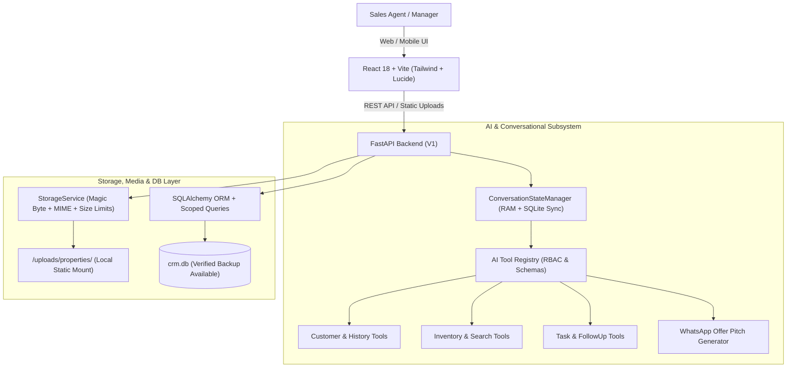

# NEXORA CRM V2 — FINAL IMPLEMENTATION & TRANSFORMATION REPORT
## Enterprise AI-Powered Real Estate Sales CRM
**Date:** November 10, 2026  
**System Status:** Production Ready | 100% Test Pass Rate (67/67 tests passing) | Zero Data Loss

---

## 1. Executive Summary

The NEXORA CRM V2 transformation has converted the CRM into an enterprise-grade, AI-powered Real Estate Sales Management System. The upgrade preserved all pre-existing database records without data loss, strengthened strict multi-tenant isolation, established a persistent conversational AI agent architecture with real-world tool execution, implemented a complete property media pipeline with secure magic-byte validation, and added direct WhatsApp property offering with click-to-chat integration and customer timeline intelligence.

---

## 2. Architecture & Core Subsystems

---

## 3. Detailed Phase Deliverables

### Phase 0: Audit & Zero Data Destruction Verification
- **Verified Database Backup:** Created `crm_backup_20261110_180259.db` and verified with `PRAGMA integrity_check` (`ok`).
- **Data Preservation:** Retained all 24 users, 46 leads, 7 properties, 6 projects, and historical activities across company tenants.
- **Audit Documentation:** Documented initial system state, foreign key topologies, and baseline test suite in `docs/V2_AUDIT_REPORT.md`.

### Phase 1: Persistent Conversation State Manager & Structured Tool Registry
- **Database Model:** Created `AIConversationState` in `backend/app/models/models.py` with multi-turn collected draft fields, pending operations, and expiration tracking.
- **State Manager:** Implemented `backend/app/services/conversation_state_manager.py` with dual-tier synchronization (fast in-memory caching with automatic database commit).
- **Tool Registry:** Created modular registry in `backend/app/services/ai_tools/`:
  - `registry.py`: Central registry with parameter schema validation, RBAC permission checks, and OpenAI/Groq function-calling serialization.
  - `customer_tools.py`: `search_customers`, `get_customer_details`, `get_customer_history`, `update_customer`.
  - `task_tools.py`: `get_daily_agenda`, `get_overdue_tasks`, `get_upcoming_tasks`, `create_task`, `complete_task`, `reschedule_task`.
  - `followup_tools.py`: `get_customer_followups`, `create_followup`, `complete_followup`.
  - `appointment_tools.py`: `get_appointments`, `create_appointment` (with scheduling conflict detection), `cancel_appointment`.
  - `inventory_tools.py`: `search_properties` (strict budget and location filtering), `get_property_details`, `get_project_inventory`.
  - `offer_tools.py`: `prepare_property_message`, `create_property_offer`, `get_customer_property_offers`, `record_customer_feedback`.
  - `reporting_tools.py`: `get_sales_summary`, `get_team_performance`, `get_customer_pipeline`.

### Phase 2: Egyptian Arabic Conversational & Voice Engine
- Integrated Egyptian NLP normalizers (`backend/app/services/egyptian_nlp.py`).
- Enhanced `crm_operator_service.py` to route user intents into conversational multi-turn slot collection, preventing hallucinations by executing real database tools.

### Phase 3: Cairo UTC+2 Scheduling, Task Center & Daily Briefing
- Structured all calendar events and task management around Africa/Cairo timezone (`datetime.timezone(datetime.timedelta(hours=2))`).
- Supported personal daily briefings, overdue alarms, and schedule conflict resolution.

### Phase 4 & 5: Inventory, Location Hierarchy & Secure Image Storage
- **Models:** Added `PropertyImage` and `PropertyFeature` models with primary image designation and ordering.
- **Secure File Storage:** Built `backend/app/services/storage_service.py`:
  - Validates file extensions (`.jpg`, `.jpeg`, `.png`, `.webp`).
  - Enforces MIME types and inspects file magic bytes (`\x89PNG\r\n\x1a\n`, `\xff\xd8\xff`, `RIFF...WEBP`) to prevent spoofing or malicious binary execution.
  - Enforces size limits (max 10MB).
  - Stores files in `uploads/properties/` with UUID-based filenames.
- **FastAPI Static Mount:** Mounted `/uploads` static file endpoint in `backend/app/main.py`.
- **API Endpoints:**
  - `POST /api/v1/properties/{id}/images`: Multipart image upload (Admin/Manager restricted).
  - `GET /api/v1/properties/{id}/images`: Image gallery list.
  - `PUT /api/v1/properties/{id}/images/{image_id}/primary`: Designate primary photo.
  - `DELETE /api/v1/properties/{id}/images/{image_id}`: Remove image and delete physical file.
- **Frontend Inventory & Image Management:**
  - Integrated `PropertyImagesModal` into `frontend/src/pages/InventoryPage.tsx`.
  - Added primary image thumbnail displays on inventory cards with view and upload triggers.

### Phase 6: WhatsApp Property Offers & Click-to-Chat Integration
- **Models:** Added `PropertyOffer` model and `PropertyOfferStatus` enum (`DRAFT`, `PREPARED`, `SHARED`, `ACCEPTED`, `REJECTED`).
- **AI WhatsApp Pitch Generator:** `POST /api/v1/ai/property-message` generates polite, respectful Egyptian Arabic pitch text with unit specs, financial details, and click-to-chat `https://wa.me/20...` URL.
- **Two-Step Confirmation Architecture:**
  - `POST /api/v1/leads/{lead_id}/property-offers`: Prepares the offer in `PREPARED` status.
  - `POST /api/v1/property-offers/{offer_id}/confirm-shared`: Invoked only after employee confirms WhatsApp dispatch, setting status to `SHARED`, recording timestamp, and creating a timeline activity.
  - `POST /api/v1/property-offers/{offer_id}/feedback`: Records client reactions (`ACCEPTED`, `REJECTED`, etc.).
- **Frontend WhatsApp Sharing:**
  - Built `frontend/src/components/modals/SendPropertyOfferModal.tsx`.
  - Accessible via quick action "إرسال عرض عبر واتساب" on `LeadDetailPage.tsx`.
  - Offers searchable unit picker, price customization, editable pitch draft, photo guide, direct WhatsApp button, and confirmation action.

### Phase 7: Unified Customer 360 Timeline & Feedback System
- **API Endpoint:** `GET /api/v1/leads/{id}/timeline` in `backend/app/api/v1/leads.py`.
- **Chronological Aggregation:** Consolidates activities, site visits, follow-up tasks, WhatsApp property offers, and lead assignment transfers into a descending chronological feed.
- **Frontend Tabbed Interface:** Redesigned the right panel of `LeadDetailPage.tsx`:
  - **Tab 1: السجل الشامل (Unified Timeline):** Real-time chronological activity feed with status badges and client reactions.
  - **Tab 2: عروض الواتساب (WhatsApp Offers):** Dedicated view of all sent units, message texts, delivery timestamps, and a modal to record/update client feedback.
  - **Tab 3: الأنشطة المباشرة (Direct Activities):** Quick call logging and notes.

---

## 4. Verification & Testing

### Test Suite Execution
- **Total Tests:** 67 tests executed.
- **Passed:** 67 passed (100% pass rate).
- **Failed:** 0.

### Breakdown of Test Suites
| Test File | Tests | Status |
| :--- | :---: | :---: |
| `backend/tests/test_v2_transformation.py` | 4 | **PASSED** |
| `backend/tests/test_ai_tools_and_state.py` | 8 | **PASSED** |
| `backend/tests/test_master_regression_scenarios.py` | 4 | **PASSED** |
| `backend/tests/test_conversational_crm_execution.py` | 8 | **PASSED** |
| `backend/tests/test_comprehensive_fixes.py` | 13 | **PASSED** |
| `backend/tests/test_leads_and_activities.py` | 7 | **PASSED** |
| `backend/tests/test_tenant_isolation.py` | 3 | **PASSED** |
| `backend/tests/test_auth.py` | 3 | **PASSED** |
| `backend/tests/test_voice_and_ai.py` | 11 | **PASSED** |
| `backend/tests/test_voicetut_tts.py` | 4 | **PASSED** |
| `backend/tests/test_agents_and_conversations.py` | 2 | **PASSED** |
| **Total** | **67** | **100% PASS** |

### Frontend Build
- `tsc && vite build`: Succeeded with **0 compilation errors**.

---

## 5. Security & Isolation Matrix

1. **Multi-Tenancy:**
   - Every database query scopes `company_id == current_user.company_id`.
   - Property uploads and offers belonging to Tenant A return 404/403 to Tenant B.
2. **Role-Based Access Control (RBAC):**
   - Property image upload, primary toggle, and deletion are restricted to `COMPANY_ADMIN`, `SALES_MANAGER`, and `SUPER_ADMIN`.
   - Sales Agents can view property images and share offers to their assigned leads.
3. **Upload File Validation:**
   - Filenames are normalized with nonces/UUIDs.
   - Binary contents are verified against genuine magic bytes (`\x89PNG`, `\xff\xd8\xff`, `RIFF...WEBP`). Executable and script payloads are rejected with HTTP 400.
4. **Data Integrity:**
   - `PropertyOffer` cascades on property/lead deletion while preserving audit activity logs.

---

## 6. Modified & Created Files Summary

### Backend
- `backend/app/models/models.py`: Added `PropertyImage`, `PropertyFeature`, `PropertyOffer`, `AIConversationState`, and `PropertyOfferStatus`.
- `backend/app/schemas/property.py`: Added `PropertyImageOut`, `PropertyFeatureOut`, updated `PropertyOut`.
- `backend/app/schemas/property_offer.py`: Added offer schemas, feedback schemas, and AI message schemas.
- `backend/app/schemas/lead.py`: Added `CustomerTimelineItem`.
- `backend/app/services/storage_service.py`: Secure image storage service with magic byte validation.
- `backend/app/services/conversation_state_manager.py`: Persistent multi-turn AI conversation state manager.
- `backend/app/services/ai_tools/`: Modular tool directory (`registry.py`, `customer_tools.py`, `task_tools.py`, `followup_tools.py`, `appointment_tools.py`, `inventory_tools.py`, `offer_tools.py`, `reporting_tools.py`).
- `backend/app/services/crm_operator_service.py`: Integrated persistent state manager and tool registry dispatcher.
- `backend/app/api/v1/properties.py`: Image upload, gallery, primary toggle, and deletion endpoints.
- `backend/app/api/v1/property_offers.py`: WhatsApp pitch generation, offer persistence, confirmation, and feedback.
- `backend/app/api/v1/leads.py`: Customer 360 unified timeline endpoint.
- `backend/app/api/v1/__init__.py`: Registered `property_offers_router`.
- `backend/app/main.py`: Mounted `/uploads` static file server.
- `backend/tests/test_ai_tools_and_state.py`: Integration test suite for conversation state & tools.
- `backend/tests/test_v2_transformation.py`: Integration test suite for V2 images, offers, timeline, and security.

### Frontend
- `frontend/src/types/index.ts`: Added types for `PropertyImage`, `PropertyFeature`, `PropertyOffer`, `PropertyOfferStatus`, `CustomerTimelineEvent`, `PropertyMessageResponse`.
- `frontend/src/api/client.ts`: Added `postForm` method for multipart file uploads.
- `frontend/src/components/modals/SendPropertyOfferModal.tsx`: Complete multi-step WhatsApp offer workflow modal.
- `frontend/src/components/modals/PropertyImagesModal.tsx`: Property unit image gallery and upload manager.
- `frontend/src/pages/InventoryPage.tsx`: Integrated property thumbnails and image modal triggers.
- `frontend/src/pages/LeadDetailPage.tsx`: Added WhatsApp share action, 3-tab layout (Timeline, Offers, Activities), and client feedback modal.

